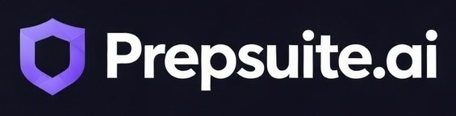
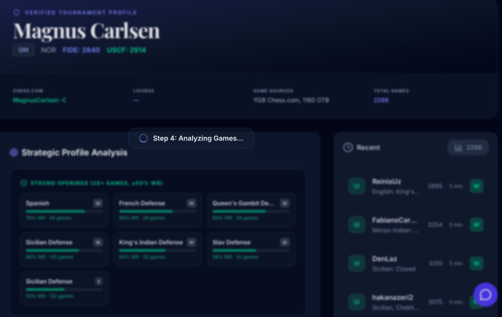
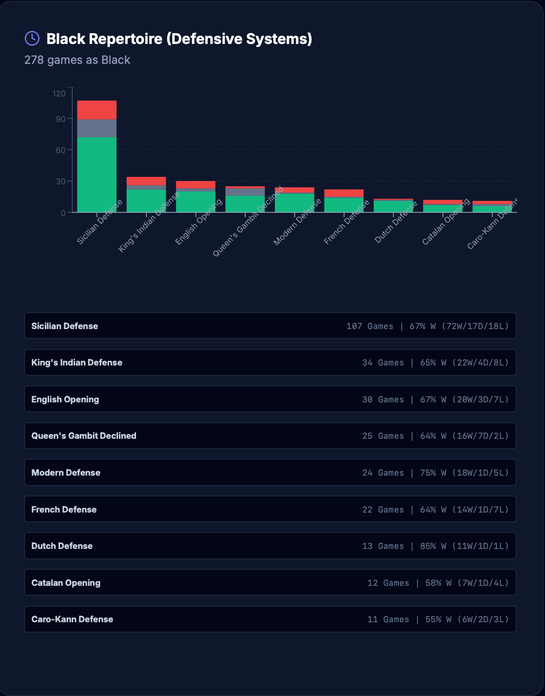

<p align="center">
  <a href="https://prepsuite.ai">
    
  </a>
</p>

<p align="center">
  <strong>The chess scouting platform that links OTB tournament data with online accounts using AI.</strong>
</p>

<p align="center">
  <a href="https://prepsuite.ai">Live Site</a> ·
  <a href="#how-the-pipeline-works">How It Works</a> ·
  <a href="#getting-started">Getting Started</a> ·
  <a href="#community">Community</a>
</p>

---

## About PrepSuite

PrepSuite combines public Chess.com, Lichess and over-the-board games into opponent preparation reports. Opening statistics and clock observations are calculated from game data; AI assists public identity discovery and on-demand chat. Historical results are not engine-confirmed weaknesses.

Suggested online accounts must be reviewed against the intended player. Where available, reports retain discovery citations and distinguish supplied handles from discovered accounts.

<p align="center">
  
</p>

### Why players use it

- **Tournament prep in minutes, not hours.** Search any opponent by name and get a full scouting dossier — opening tendencies, clock habits, win/loss patterns — without manually digging through multiple websites.
- **AI-powered identity resolution.** Enter a FIDE name and PrepSuite finds their Chess.com and Lichess accounts automatically using Google Gemini.
- **Over-the-board + online data, unified.** Combine available OTB tournament games with public online game histories, with separate source and color views.
- **Exportable PDF reports.** Download a print-ready scouting report with charts, stats, and tactical summaries to bring to the tournament hall.

---

## How the Pipeline Works

PrepSuite's analysis engine is a **multi-phase pipeline service** built on Node.js and Hono, deployed to Google Cloud Run. When a user submits a search, the pipeline executes the following phases and streams real-time progress back to the client via Server-Sent Events (SSE):

```
┌─────────────────────────────────────────────────────────────────────┐
│                        User submits search                         │
│                  (name, FIDE ID, or username)                      │
└────────────────────────────┬────────────────────────────────────────┘
                             │
                             ▼
┌─────────────────────────────────────────────────────────────────────┐
│  Phase 1 — Identity Resolution                                     │
│  • Query FIDE database for player profile and rating history       │
│  • Query USCF database for US tournament data                      │
│  • Use Google Gemini AI to resolve online usernames                │
│    (Chess.com / Lichess) from the player's real name               │
│  • Cross-validate candidates against known rating ranges           │
└────────────────────────────┬────────────────────────────────────────┘
                             │
                             ▼
┌─────────────────────────────────────────────────────────────────────┐
│  Phase 2 — Game Fetching (parallelized)                            │
│  • Fetch OTB games from FIDE game archive (PGN format)             │
│  • Fetch online games from Chess.com API (batch, rate-limited)     │
│  • Fetch online games from Lichess API (ndjson stream)             │
│  • Merge and deduplicate across sources                            │
│  • Configurable limit (up to 2,500 games)                          │
└────────────────────────────┬────────────────────────────────────────┘
                             │
                             ▼
┌─────────────────────────────────────────────────────────────────────┐
│  Phase 3 — PGN Parsing & Opening Classification                    │
│  • Parse each PGN with chess.js move validation                    │
│  • Classify openings via ECO code lookup + move-sequence matching  │
│  • Parallelized across worker pool for large game sets             │
│  • Compute per-opening statistics: W/D/L, win rate, frequency      │
│  • Split stats by source (OTB vs. online) and by color             │
└────────────────────────────┬────────────────────────────────────────┘
                             │
                             ▼
┌─────────────────────────────────────────────────────────────────────┐
│  Phase 4 — Evidence-based report                                   │
│  • Assemble validated opening and game statistics                  │
│  • Keep online and OTB results separate                            │
│  • Present sampled historical scores with draw context             │
│  • AI chat and engine evaluation are available on demand            │
└────────────────────────────┬────────────────────────────────────────┘
                             │
                             ▼
┌─────────────────────────────────────────────────────────────────────┐
│  Output — Scouting Report                                          │
│  • Streamed to client via SSE as each phase completes              │
│  • Saved to Supabase (30-day cache per user)                       │
│  • Exportable as multi-page PDF with section-aware page breaks     │
│  • Interactive repertoire analysis board with move tree navigation  │
│  • AI chat for follow-up questions about the opponent's repertoire │
└─────────────────────────────────────────────────────────────────────┘
```

<p align="center">
  
</p>

---

## Features

| Feature | Description |
|---|---|
| **Multi-Source Identity Resolution** | Search by name, FIDE ID, USCF ID, Chess.com username, or Lichess username. AI links identities across platforms. |
| **Opening Repertoire Analysis** | Stacked W/D/L charts for White and Black, split by OTB vs. online, with per-opening win rates and game counts. |
| **Interactive Analysis Board** | Click through an opponent's most-played opening lines with a notation breadcrumb and quick insights. |
| **Time Management Profiling** | Flag game analysis, win/loss by termination type, clock pressure patterns across time controls. |
| **Tactical Summary** | AI-generated bullet points highlighting the opponent's weakest openings and clock vulnerabilities. |
| **Repertoire Chat** | Ask follow-up questions about the opponent's repertoire in a conversational AI interface. |
| **PDF Export** | Download the full report as a formatted multi-page PDF with charts, stats, and tactical summaries. |
| **Guest Trial Mode** | Try the platform without signing up — analyze up to 500 games from the landing page. |
| **Report History** | Save, revisit, and manage past scouting reports tied to your account. |
| **FIDE Rating History** | Visualize an opponent's classical, rapid, and blitz rating progression over time. |

---

## Tech Stack

| Layer | Technologies |
|---|---|
| **Frontend** | React 19, TypeScript, Vite 8, Tailwind CSS 4, Motion |
| **Backend (Pipeline)** | Node.js 24, Hono, Google Cloud Run |
| **AI** | Google Gemini (multi-model fallback chain) |
| **Database & Auth** | Supabase (PostgreSQL + Row-Level Security + Auth) |
| **Serverless** | Supabase Edge Functions (Deno) |
| **Chess Logic** | chess.js (PGN parsing, move validation) |
| **Visualization** | Recharts, react-chessboard |
| **Testing** | Vitest, PGlite database regression tests, Playwright browser tests |
| **Error Tracking** | Sentry |
| **Deployment** | Vercel (frontend), Cloud Run (pipeline), Supabase (DB/auth/functions) |

---

## Architecture

```
                    ┌──────────────┐
                    │   Browser    │
                    │  (React/TS)  │
                    └──────┬───────┘
                           │ HTTPS
                    ┌──────▼───────┐
                    │    Vercel    │
                    │  (Frontend)  │
                    └──────┬───────┘
                           │ /api/* proxy
                    ┌──────▼───────┐         ┌───────────────┐
                    │  Cloud Run   │────────▶│  Google Gemini │
                    │  (Pipeline)  │         │   (AI Models)  │
                    └──────┬───────┘         └───────────────┘
                           │
              ┌────────────┼────────────┐
              ▼            ▼            ▼
        ┌──────────┐ ┌──────────┐ ┌──────────┐
        │ Chess.com│ │  Lichess │ │   FIDE   │
        │   API    │ │   API    │ │  + USCF  │
        └──────────┘ └──────────┘ └──────────┘
                           │
                    ┌──────▼───────┐
                    │   Supabase   │
                    │  (Postgres)  │
                    │  Auth + RLS  │
                    └──────────────┘
```

---

## Project Structure

```
prepsuite/
├── src/                        # Frontend application
│   ├── App.tsx                 # Root component, state management, routing
│   ├── types.ts                # Core TypeScript interfaces
│   ├── components/             # React components
│   │   ├── LandingPage.tsx     # Public landing page with guest trial
│   │   ├── SearchScreen.tsx    # Search form and analysis configuration
│   │   ├── ReportDashboard.tsx # Full scouting report display
│   │   ├── RepertoireChat.tsx  # AI chat for repertoire questions
│   │   ├── AnalysisBoard.tsx   # Interactive chessboard with move tree
│   │   └── ...
│   ├── services/               # API clients
│   │   ├── pipelineClient.ts   # SSE client for the pipeline service
│   │   └── playerRepository.ts # Supabase CRUD for players/reports
│   ├── lib/                    # Utilities (Supabase, Zod, PDF export, Sentry)
│   └── hooks/                  # Custom React hooks
├── pipeline-service/           # Backend analysis pipeline (Node/Hono)
│   ├── src/
│   │   ├── pipeline/           # Core pipeline modules
│   │   │   ├── identityResolver.ts   # AI-powered cross-platform identity matching
│   │   │   ├── gameFetcher.ts        # Multi-source game aggregation
│   │   │   ├── openingClassifier.ts  # ECO code lookup + move classification
│   │   │   ├── geminiReport.ts       # AI report generation
│   │   │   └── geminiFallback.ts     # Multi-model fallback chain
│   │   ├── routes/             # HTTP endpoints (/api/analyze, /api/chat)
│   │   └── lib/                # Shared utilities
│   └── __tests__/              # Pipeline unit tests
├── supabase/
│   ├── functions/              # Edge functions (delete-user, health)
│   └── migrations/             # Database migrations (players, scouting_reports)
├── e2e/                        # Playwright E2E tests
└── docs/                       # Architecture, deployment, security docs
```

---

## Getting Started

### Prerequisites

- Node.js 24+
- npm
- Supabase account
- Google Cloud project with Vertex AI enabled and Application Default Credentials

### Quick Start

```bash
# Clone the repository
git clone https://github.com/your-username/prepsuite.git
cd prepsuite

# Install frontend dependencies
npm install

# Set up environment variables
cp .env.example .env.local
# Edit .env.local with your Supabase URL and anon key

# Set up and start the pipeline service
cd pipeline-service
cp .env.example .env
# Edit .env with Supabase credentials and VERTEX_PROJECT_ID
# Authenticate locally: gcloud auth application-default login
npm install && npm run dev    # Runs on port 8080

# In another terminal — start the frontend
cd ..
npm run dev                   # Runs on port 3000
```

The Vite dev server proxies `/api/*` to the pipeline service automatically.

### Database Setup

```bash
supabase link --project-ref your-project-ref
supabase db push
supabase functions deploy delete-user
supabase functions deploy health
```

---

## Available Scripts

| Command | Description |
|---|---|
| `npm run dev` | Start dev server (port 3000) |
| `npm run build` | Production build (strips console.log/debugger) |
| `npm run preview` | Preview production build |
| `npm test` | Run Vitest in watch mode |
| `npm run test:run` | Run Vitest once (CI mode) |
| `npm run test:coverage` | Run with coverage (70% threshold) |
| `npm run test:e2e` | Playwright E2E tests (Chromium, Firefox, WebKit) |
| `npm run test:all` | Unit tests + E2E tests |

---

## Security

- **Server-side secrets only** — All API keys (Gemini, Supabase service role) stored exclusively in the pipeline service and edge functions
- **JWT verification** — Every pipeline request validated against Supabase JWT secret
- **Input validation** — Zod schemas on all user inputs before processing
- **Row-Level Security** — Supabase RLS policies enforce per-user data isolation
- **Rate limiting** — IP-based rate limiting on guest analysis endpoints

See [`docs/SECURITY_AUDIT.md`](docs/SECURITY_AUDIT.md) for the full security analysis.

---

## Community

PrepSuite is actively used by **100+ competitive chess players** for tournament preparation — from club-level to titled players. The platform has analyzed hundreds of thousands of games across Chess.com, Lichess, and FIDE/USCF sources.

If you're a chess player preparing for a tournament, try it now at **[prepsuite.ai](https://prepsuite.ai)**.

---

## Documentation

- [`docs/ARCHITECTURE.md`](docs/ARCHITECTURE.md) — System architecture
- [`docs/DEPLOYMENT_SETUP.md`](docs/DEPLOYMENT_SETUP.md) — Deployment and CI/CD
- [`docs/SECURITY_AUDIT.md`](docs/SECURITY_AUDIT.md) — Security audit
- [`docs/SETUP_CHECKLIST.md`](docs/SETUP_CHECKLIST.md) — Initial setup checklist
- [`docs/OAUTH_SETUP.md`](docs/OAUTH_SETUP.md) — OAuth configuration

---

## License

This project is proprietary software. All rights reserved.

---

<p align="center">
  <strong>Built for the chess community</strong><br>
  <a href="https://prepsuite.ai">prepsuite.ai</a>
</p>


## October 2026 implementation and rollout

The landing page has one React implementation. The old HTML hero and asynchronous stylesheet swap were removed to prevent a different screen or unstyled content appearing on reload. TASA Orbiter and Geist Mono load from Google Fonts; Motion reveals respect reduced-motion preferences. The new layout includes direct username search, public samples, an explanation of the workflow, an FAQ, and forms that wait for authentication results.

Reports now include a color-specific preparation panel, source/speed/date filters, supporting games, score including draws, sample-size labels, rating expectation when ratings are complete, and a one-page round sheet. Practice identifies recorded repertoire moves and Stockfish continuations; it no longer silently substitutes an arbitrary move. Engine output is not a calibrated simulation of an individual player.

Performance changes include 30-row history pages with full reports loaded on selection, deferred PDF/board/practice code, shared parsed-game histories, and a byte-bounded public archive cache that coalesces concurrent fetches. Featured reports load summaries before game pages. Rebuild those artifacts using `npm run samples:build`. The Magnus snapshot's initial JSON is approximately 120 KiB instead of 6.5 MiB; full games download only when requested.

### Models and validation

Task-specific model IDs live in `pipeline-service/src/lib/models.ts` and have environment overrides. Discovery and analysis use `gemini-3.8-flash`; support and fallback use `gemini-3.5-flash-lite`. Retired 2.5 fallbacks are removed. This is a configuration policy, not evidence of availability or quality in a particular Vertex project. Before promoting an override, run the live, billable evaluation with configured ADC:

```bash
npm --prefix pipeline-service run eval:models -- gemini-3.8-flash gemini-3.5-flash-lite
```

The small evaluation set checks draw scoring and insufficient-data responses, and emits model, latency and token-usage records. Expand it with reviewed identity and chess-analysis cases before treating it as a comprehensive model quality benchmark. The ordinary report pipeline does not spend an LLM call generating hidden clock advice.

Local checks:

```bash
npm ci
npm --prefix pipeline-service ci
npm run check
npm run build
npx playwright install chromium
npm run test:e2e -- --project=chromium
# Use installed Chrome if preferred:
PLAYWRIGHT_CHROMIUM_CHANNEL=chrome npm run test:e2e -- --project=chromium
```

Database regression tests execute the new SQL in PGlite, including function privileges, duplicate purchase fulfillment, event ordering, shared limits, lease recovery and user isolation. These are local tests; they do not inspect or modify the production database. The Stripe function is also checked with Deno.

### Required rollout order

1. Back up the target database and apply the four `20261010000*` migrations to staging, then production. Credit RPCs become service-role-only; production request limits require the new RPC. The Stripe webhook update and its database functions must ship together. Confirm the existing Stripe endpoint subscribes to subscription created/updated/deleted and checkout completed/async-payment-succeeded events.
2. Configure GitHub `staging` and `production` environments independently: `GCP_SA_KEY`, `GCP_PROJECT_ID`, `SUPABASE_ACCESS_TOKEN`, `SUPABASE_DB_PASSWORD`, `SUPABASE_PROJECT_REF`, `VITE_SUPABASE_URL`, and `VITE_SUPABASE_ANON_KEY`; set the `CLOUD_RUN_SERVICE` environment variable. Cloud Build reads the existing `supabase-url`, `supabase-service-role-key`, and `supabase-jwt-secret` secrets in that GCP project. Separate projects should use separate secret values. Attach a service account with Vertex access. The deployment workflow runs frontend/backend checks before applying migrations and deploying the combined service.
3. Verify sign-in, a real player search, history save/load, and test-mode Stripe event replay in staging. Live credentials and external-service end-to-end behavior are not validated by mocked/local tests.
4. Enable durable analysis only after migration: set `JOBS_ENABLED=true`, use always-allocated CPU (`--no-cpu-throttling`), and set at least one minimum instance. Cloud Build accepts `_JOBS_ENABLED=true,_MIN_INSTANCES=1`. This has an idle compute cost. Authenticated searches then use the persistent job queue; existing SSE remains the fallback when jobs are explicitly disabled. Jobs retain results for seven days; browser report history persists separately. Guest previews continue to stream.
5. Verify `TRUST_PROXY_HOPS` for the actual ingress chain. Local Node defaults to zero (ignore forwarded headers); the direct Cloud Run configuration uses one trusted hop. Recheck when adding an external load balancer or CDN. Production shared limits fail closed if storage is unavailable. Validate the configured proxy chain before promoting to production.

Credits remain disabled for analysis by default, as in the existing product. An opt-in `BILLING_ENABLED=true` path reserves the maximum cost, settles actual usage, refunds failures, and recovers abandoned reservations through the durable worker. SQL tests cover these transactions. Do not enable charging without confirming pricing and testing the whole purchase/reservation flow in staging. No paid purchases, database migrations, cloud deployments, monitoring alerts, or live model evaluations are performed by `npm run check`. Operators still need to configure production alerts from request/phase/model-usage logs and verify the live rollout. No testimonials or adoption numbers were invented.

Design references: [Motion reduced-motion support](https://motion.dev/docs/react-use-reduced-motion), [Fontsource DM Sans](https://fontsource.org/fonts/dm-sans), [Fontsource Space Grotesk](https://fontsource.org/fonts/space-grotesk). Operational references: [Stripe webhook delivery behavior](https://docs.stripe.com/webhooks), [Vite 8 migration](https://vite.dev/guide/migration).

### Motion redesign and signed-in walkthrough (October 10)

The landing hero now includes a Motion-powered chess scene with legal Italian Game and Queen's Gambit sequences, spring-driven piece movement and pointer tilt, animated orbital graphics, and manual playback controls. Animation pauses outside the viewport and respects reduced motion. The authenticated workspace uses the same Google-hosted TASA Orbiter / Geist Mono typography and logo-matched purple palette with animated navigation. A clean transparent SVG shield and live wordmark replace the raster logo; the favicon uses the same shield; the illustrative board uses opaque, custom SVG pieces with contrasting outlines rather than Unicode chess glyphs.

The local sign-in failure was caused by an empty `.env.local`, which let placeholder Supabase configuration reach the network. Real public client configuration was restored locally; missing configuration now produces an actionable error before credentials are sent. Do not commit `.env.local`. `PIPELINE_PROXY_TARGET` can point local development at a trusted existing backend; signed-in writes then affect that backend's real database.

The interactive walkthrough also fixed invisible pipeline errors after report navigation, duplicate player persistence, practice retry loops and stale responses after reset, mobile practice sizing, and dialog/chat accessibility. Recorded practice lines now work without an authenticated engine call; leaving the recorded repertoire requires the backend engine.

Validation evidence:

- TypeScript checks, production frontend/backend builds, 64 frontend unit tests and 282 backend/database tests passed.
- Browser coverage includes authentication success/failure/reload/logout, account-deletion cancellation, search validation and game limits, streaming and queued analysis, report save, visible pipeline failures, offline recovery, all eight sample routes, preparation filters, PDFs, games and playback, recorded-line practice, mobile sizing, reduced motion, legal navigation, and chat success/failure recovery. Supabase writes in automated browser tests are intercepted.
- Using the existing signed-in Chrome session, a live 499-game Magnus Carlsen report (249 Chess.com, 250 OTB) completed in 23.3 seconds, saved, and reopened from history. History pagination, folder view, selection, deletion cancellation, repertoire chat and support chat worked. The new report remains in the account.
- Public guest analysis, featured games, game playback, repertoire exploration, recorded-line practice and PDF downloads were also exercised through the local UI with the existing deployed backend.

Limits: the redesign and backend changes have not been deployed. The deployed service currently lacks `/api/jobs`, so its successful live analysis used the streaming fallback. New durable jobs, billing migrations, model overrides and security changes still require the rollout above. Paid checkout, final account/report deletion, new-account verification emails, Google OAuth completion, external identity-provider failures, and out-of-book engine continuations were not exercised end to end against production. Passing local checks is not a guarantee that every external service or production configuration works.

Typography refinement: TASA Orbiter handles headings, body text, forms and controls; Geist Mono handles notation, technical values and small editorial labels. These match the families inspected on Motion.dev and load through Google Fonts. The rules cover every route and modal, replacing legacy serif and script overrides. Motion adds staggered hero and card reveals, spring hover feedback and subtle background parallax; reduced-motion preferences disable movement. References: [Motion](https://motion.dev), [Google Fonts API](https://developers.google.com/fonts/docs/css2), [Motion scroll animations](https://motion.dev/docs/react-scroll-animations), [Motion transitions](https://motion.dev/docs/react-transitions).

The Motion visual system now extends beyond the landing page: `MotionSurface` supplies shared spring entrances and optional hover lift for report sections, preparation cards, history cards, settings, dialogs, notifications, chat messages and legal pages. The support panel and FAQ use presence-based open/close transitions. A root `MotionConfig` respects reduced-motion preferences. `motion-system.css` unifies violet surfaces, borders, inputs, focus rings and responsive spacing; outcome/error colors retain their meaning. PDF export forces motion surfaces to their settled, fully opaque state. The full 32-test browser suite passed, followed by targeted report/chat/FAQ checks after finishing changes. No deployment was performed.

### Report exports and public metadata

The Preparation tab is connected to loaded report games. Its color, source, speed, and date filters persist across tab switches; its supporting-game links and one-page round sheet use the same selected sample. Empty selections disable sheet export. The full PDF includes the selected plan and captures complete sections after charts and rating history settle, using local system fonts. Profile actions occupy their own row on mobile, and unavailable player titles are labeled explicitly.

`src/lib/publicPages.ts` supplies route-specific titles, descriptions, canonical URLs, social metadata, and structured data. The build generates readable initial HTML for the homepage and eight sample reports, distinct public information pages, a 12-URL sitemap, and noindex documents for workspace routes. Vite preview and Vercel route to these documents; the pipeline static server supports directory indexes. `public/prepsuite-social.png` is the 1200×630 social image. Landing copy now explicitly describes connecting tournament players to Chess.com/Lichess accounts and combining online and over-the-board games.

Validation: TypeScript, 70 frontend tests, 316 pipeline tests, production build, direct HTML checks, browser mobile/preparation checks, and visual inspection of the four-page report and one-page round sheet. Deployed on October 11, 2026. See [the production release record](docs/releases/2026-10-11.md) for the original scope and verification. The subsequent [ratings repair release](docs/releases/2026-10-11-ratings.md) restores live history using official FIDE first and a dynamic backup, caps FIDE/USCF enrichment at 6.5 seconds, and fixes search focus spacing. Direct FIDE connections from production still fail; current successful live history uses the attributed backup, whose coverage can lag FIDE. Earlier deployment statements above describe the historical state; unrelated backend/migration work remains undeployed.
